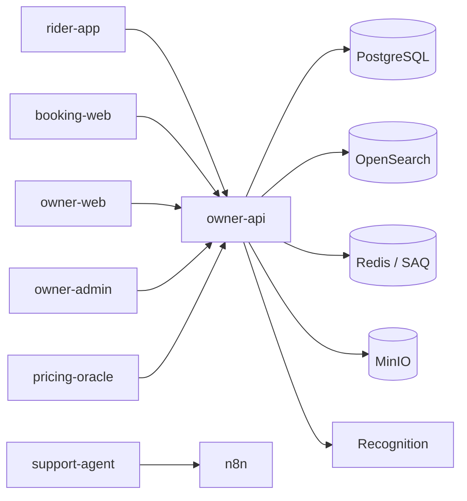

# Org Profile Refresh Implementation Plan

> **For agentic workers:** REQUIRED SUB-SKILL: Use superpowers:subagent-driven-development (recommended) or superpowers:executing-plans to implement this plan task-by-task. Steps use checkbox (`- [ ]`) syntax for tracking.

**Goal:** Make `Ownima/.github` a truthful, healthy org profile for the team and AI agents, and add a guard that catches future drift.

**Architecture:** A layered `profile/README.md` (public products first, internal engineering map second), a refreshed `RELEASING.md`, org-wide community health files, and a small shell guard run by GitHub Actions. GitHub settings and repository metadata are applied with `gh` outside git.

**Tech Stack:** Markdown, Bash, GitHub CLI, GitHub Actions, Mermaid.

**Spec:** `docs/superpowers/specs/2026-10-19-org-profile-refresh-design.md`

---

### Task 1: Rewrite the profile README

**Files:**
- Modify: `profile/README.md`

- [ ] **Step 1: Replace `profile/README.md` with the content below**

````markdown
# Ownima — Vehicle Rental Management Platform

**One platform for rental businesses and their riders: fleet, reservations, pricing and finance.**

---

## Live products

| Product | URL | Audience |
|---|---|---|
| Ownima | [ownima.com](https://ownima.com) | Public site |
| Rider marketplace | [rider.ownima.com](https://rider.ownima.com) | Riders across all owners |
| Booking storefront | [booking.ownima.com](https://booking.ownima.com) | Riders of one owner |
| Owner cabinet | [beta.ownima.com](https://beta.ownima.com) | Rental owners |
| Admin panel | [admin.ownima.com](https://admin.ownima.com) | Ownima operators |

---

## Platform

- Three roles: owner, rider, admin, with role-based access control.
- Fleet and vehicle management, images stored in MinIO.
- Reservations with real-time availability and a booking request flow.
- Pricing templates (seasonal, duration-based) and a market pricing oracle.
- Wallet, transactions and financial dashboards.
- Five locales: English, Russian, Thai, Indonesian, Vietnamese.
- Background jobs on a SAQ worker queue.
- AI support drafting and vehicle image recognition.

---

## Repositories

Product repositories are private; links work for Ownima members.

| Repository | Role | Stack |
|---|---|---|
| [owner-api](https://github.com/Ownima/owner-api) `(private)` | REST API, workers, Telegram bot, protobuf schema | Python 3.12 · FastAPI · PostgreSQL · OpenSearch · Redis · MinIO · SAQ |
| [owner-web](https://github.com/Ownima/owner-web) `(private)` | Owner dashboard, Capacitor mobile app | React 19 · TypeScript · TanStack · Tailwind 4 · Vite · bun |
| [owner-admin](https://github.com/Ownima/owner-admin) `(private)` | Internal admin panel | React 19 · TanStack Query · Radix · Tailwind 4 · Vitest · bun |
| [booking-web](https://github.com/Ownima/booking-web) `(private)` | Rider storefront for a single owner, embeddable widget | Nuxt 4 · Vue 3 · Pinia · TanStack Vue Query · Tailwind 4 · bun |
| [rider-app](https://github.com/Ownima/rider-app) `(private)` | Multi-owner rental marketplace | Nuxt 4 · Vue 3 · FSD · Pinia · Tailwind 4 · Vercel |
| [support-agent](https://github.com/Ownima/support-agent) `(private)` | AI support drafting, knowledge base, evals | Python 3.12 · Claude · n8n |
| [pricing-oracle](https://github.com/Ownima/pricing-oracle) | Rental pricing market intelligence | Python 3.12 · FastAPI · SQLModel · A2A · Fetch.ai |
| [ownima-blog](https://github.com/Ownima/ownima-blog) `(private)` | SEO site for the Thailand market | Astro 6 · TypeScript · pagefind · bun |
| [ansible](https://github.com/Ownima/ansible) `(private)` | Infrastructure, deployment, monitoring, runbooks | Ansible · Docker · Prometheus · Grafana · Loki |
| [ownima-workspace](https://github.com/Ownima/ownima-workspace) `(private)` | Workspace guide and shared agent skills | Bash · Markdown |

---

## Architecture



---

## For AI agents

Start at [ownima-workspace](https://github.com/Ownima/ownima-workspace): it holds the
workspace guide and the shared skills. Each repository has an `AGENTS.md` with its own
commands and rules. `CLAUDE.md` only imports `AGENTS.md`.

---

## Releasing

Release Please derives versions from conventional commits. See [RELEASING.md](../RELEASING.md).

---

## Team

| Role | GitHub |
|---|---|
| Backend / Architecture | [@zaebee](https://github.com/zaebee) |
| Product / QA | [@ownima-ivan](https://github.com/ownima-ivan) |
| Frontend | [@ReD1KC](https://github.com/ReD1KC) |

---

Contact: **contact@ownima.com**
Security: [private advisories](https://github.com/Ownima/.github/security/advisories/new)
````

- [ ] **Step 2: Verify no stale names remain**

Run: `rg -n "rider-web|ownima-admin|app\.ownima\.com|React 18" profile/README.md`
Expected: no output.

- [ ] **Step 3: Commit**

```bash
git add profile/README.md
git commit -m "docs(profile): refresh products, repositories and team"
```

---

### Task 2: Refresh the root README and RELEASING

**Files:**
- Modify: `README.md`
- Modify: `RELEASING.md`

- [ ] **Step 1: Replace `README.md` with the content below**

````markdown
# Ownima/.github

Org-wide defaults and documentation for the [Ownima](https://github.com/Ownima)
GitHub organization.

## Contents

- [`profile/README.md`](profile/README.md) — organization profile shown on
  [github.com/Ownima](https://github.com/Ownima)
- [`RELEASING.md`](RELEASING.md) — release process and conventional commit guide
- [`CONTRIBUTING.md`](CONTRIBUTING.md) — branches, commits and PR rules
- [`SECURITY.md`](SECURITY.md) — how to report a vulnerability
- [`SUPPORT.md`](SUPPORT.md) — where to ask for help
- [`CODE_OF_CONDUCT.md`](CODE_OF_CONDUCT.md) — expected behavior

## Changing the profile

Open a pull request against `main`. The `profile-links` workflow checks repository
links, live domains and repository coverage on every PR and once a week.

## Issues

Cross-repo and backlog tasks are tracked here as
[GitHub Issues](https://github.com/Ownima/.github/issues).
````

- [ ] **Step 2: Replace `RELEASING.md` with the content below**

````markdown
# Releasing

Ownima uses [Release Please](https://github.com/googleapis/release-please) to
automate versioning and changelog generation.

## How it works

Release Please watches commits on `main` and derives the next version from
conventional commit prefixes:

| Commit prefix | Version bump | Example |
|---|---|---|
| `fix: ...` | patch | `0.2.28` → `0.2.29` |
| `feat: ...` | minor | `0.2.28` → `0.3.0` |
| `feat!: ...` or `BREAKING CHANGE:` in the body | major | `0.2.28` → `1.0.0` |
| `chore:`, `docs:`, `refactor:`, `ci:`, … | none | no release PR on its own |

On every push to `main` it either:

1. creates or updates a release PR titled `chore(main): release X.Y.Z` with an
   autogenerated changelog, or
2. tags and releases when that PR is merged.

## Repositories

| Repository | Versioning |
|---|---|
| `owner-api` | `release-please-config.json` + `.release-please-manifest.json` (key `ownima-backend`) |
| `owner-web` | `release-please-config.json` + `.release-please-manifest.json` |
| `booking-web` | `release-please-config.json` + `.release-please-manifest.json` |
| `rider-app` | `release-please-config.json` + `.release-please-manifest.json` |

They use a GitHub App token (`OWNIMA_BOT_APP_ID` + `OWNIMA_BOT_PRIVATE_KEY`)
instead of `GITHUB_TOKEN`, because the organization restricts PR creation for
Actions. `rider-app` builds and deploys on Vercel from `main`.

## Workflow

```
push to main
    └─► release-please runs
            ├─ no releasable commits → nothing happens
            └─ releasable commits found
                    ├─ release PR already open → updates it
                    └─ no open release PR → creates one
                                └─ merge release PR
                                        └─ creates git tag + GitHub Release
```

## Tips

- **Force a version**: put `Release-As: X.Y.Z` as a trailer in a commit on
  `main`. Release Please picks it up on the next run.
- **Hold a release**: leave the release PR open; it keeps updating.
- **Non-releasable commits** (`chore:`, `ci:`, `docs:`) do not trigger a
  release PR on their own, but they do not reset one that is already open.
````

- [ ] **Step 3: Verify RELEASING lists four repositories**

Run: `rg -c "release-please-config.json" RELEASING.md`
Expected: `4` (table rows; the intro link does not match this string).

- [ ] **Step 4: Commit**

```bash
git add README.md RELEASING.md
git commit -m "docs: refresh repo readme and releasing guide"
```

---

### Task 3: Add security, support and contribution files

**Files:**
- Create: `SECURITY.md`
- Create: `SUPPORT.md`
- Create: `CONTRIBUTING.md`

- [ ] **Step 1: Create `SECURITY.md`**

````markdown
# Security Policy

## Reporting a vulnerability

Report vulnerabilities through
[GitHub private advisories](https://github.com/Ownima/.github/security/advisories/new).
If you cannot use GitHub, email **contact@ownima.com**.

Please include:

- affected repository and version or commit;
- steps to reproduce;
- impact you believe it has;
- any suggested fix.

Do not open a public issue for a vulnerability. We aim to acknowledge a report
within two working days and to keep you updated until it is resolved.

## Supported versions

Only the latest release of each service is supported. Security fixes are applied
to `main` and released through the normal Release Please flow.
````

- [ ] **Step 2: Create `SUPPORT.md`**

````markdown
# Support

## Product questions

Email **contact@ownima.com** or reach the team in the internal chat.

## Bugs and feature requests

Open an issue in the repository that owns the behavior:

| Area | Repository |
|---|---|
| API, workers, data | `Ownima/owner-api` |
| Owner dashboard | `Ownima/owner-web` |
| Internal admin panel | `Ownima/owner-admin` |
| Rider storefront | `Ownima/booking-web` |
| Rider marketplace | `Ownima/rider-app` |
| Support automation | `Ownima/support-agent` |
| Pricing oracle | `Ownima/pricing-oracle` |
| SEO site | `Ownima/ownima-blog` |
| Infrastructure and deploys | `Ownima/ansible` |
| Workspace guide and skills | `Ownima/ownima-workspace` |

Use this repository only for cross-repo or organization-level issues.

## Security

See [SECURITY.md](SECURITY.md).
````

- [ ] **Step 3: Create `CONTRIBUTING.md`**

````markdown
# Contributing

## Branches

Use `<type>/<issue>-<slug>`, for example `fix/1219-time-slot-parse`. The default
branch is `main` in every repository.

## Commits

Conventional Commits: `type(scope): subject`. Types in use: `feat`, `fix`,
`refactor`, `chore`, `ci`, `test`, `docs`, `perf`, `style`, `build`, `revert`.

## Pull requests

- Keep a PR to one change.
- Link the issue when one exists.
- Make CI green before asking for review: tests, lint, typecheck and build for
  the repository you touched.
- A backend request from a frontend repository is an issue on
  `Ownima/owner-api`, not a task file in the frontend repository.
- Cross-repository references are full URLs.

## Types and schemas

Frontends generate their API types from the backend OpenAPI schema. Never
hand-edit generated directories (`gen`, `gen_types`). Regenerate and commit the
snapshot instead.

## Where to ask

See [SUPPORT.md](SUPPORT.md).
````

- [ ] **Step 4: Commit**

```bash
git add SECURITY.md SUPPORT.md CONTRIBUTING.md
git commit -m "docs: add security, support and contributing guides"
```

---

### Task 4: Add conduct, templates and a minimal gitignore

**Files:**
- Create: `CODE_OF_CONDUCT.md`
- Create: `ISSUE_TEMPLATE/bug.yml`
- Create: `ISSUE_TEMPLATE/feature.yml`
- Create: `ISSUE_TEMPLATE/config.yml`
- Create: `PULL_REQUEST_TEMPLATE.md`
- Modify: `.gitignore`

- [ ] **Step 1: Create `CODE_OF_CONDUCT.md` from Contributor Covenant 2.1**

Run:

```bash
curl -fsSL https://www.contributor-covenant.org/version/2/1/code_of_conduct/code_of_conduct.md \
  -o CODE_OF_CONDUCT.md
sed -i 's/\[INSERT CONTACT METHOD\]/contact@ownima.com/g' CODE_OF_CONDUCT.md
```

Expected: `CODE_OF_CONDUCT.md` is present and contains `contact@ownima.com`.

- [ ] **Step 2: Create `ISSUE_TEMPLATE/bug.yml`**

````yaml
name: Bug report
description: Something is broken
labels: [bug]
body:
  - type: input
    id: repository
    attributes:
      label: Repository
      placeholder: Ownima/owner-api
    validations:
      required: true
  - type: textarea
    id: what-happened
    attributes:
      label: What happened
      description: Observed behavior and what you expected instead
    validations:
      required: true
  - type: textarea
    id: reproduce
    attributes:
      label: Steps to reproduce
    validations:
      required: true
  - type: textarea
    id: context
    attributes:
      label: Environment and context
      description: Version, environment, logs, screenshots
    validations:
      required: false
````

- [ ] **Step 3: Create `ISSUE_TEMPLATE/feature.yml`**

````yaml
name: Feature request
description: Propose a capability
labels: [enhancement]
body:
  - type: textarea
    id: problem
    attributes:
      label: Problem
      description: What user problem does this solve?
    validations:
      required: true
  - type: textarea
    id: proposal
    attributes:
      label: Proposal
      description: What should change?
    validations:
      required: true
  - type: textarea
    id: alternatives
    attributes:
      label: Alternatives considered
    validations:
      required: false
````

- [ ] **Step 4: Create `ISSUE_TEMPLATE/config.yml`**

````yaml
blank_issues_enabled: false
contact_links:
  - name: Security report
    url: https://github.com/Ownima/.github/security/advisories/new
    about: Report a vulnerability privately
  - name: Support
    url: https://github.com/Ownima/.github/blob/main/SUPPORT.md
    about: Where to ask for help
````

- [ ] **Step 5: Create `PULL_REQUEST_TEMPLATE.md`**

````markdown
## What

<!-- What changed and why -->

## Verification

- [ ] Tests, lint and typecheck run for the touched repository
- [ ] UI change applied to every surface of the entity
- [ ] Cross-repository references are full URLs

## Notes

<!-- Migrations, feature flags, follow-ups -->
````

- [ ] **Step 6: Replace `.gitignore` with a minimal one**

```gitignore
.DS_Store
Thumbs.db
*.swp
.idea/
.vscode/
```

- [ ] **Step 7: Verify structure**

Run: `ls CODE_OF_CONDUCT.md PULL_REQUEST_TEMPLATE.md ISSUE_TEMPLATE/bug.yml ISSUE_TEMPLATE/feature.yml ISSUE_TEMPLATE/config.yml`
Expected: all five paths listed.

Run: `rg -n "INSERT CONTACT METHOD|TBD|TODO" CODE_OF_CONDUCT.md SECURITY.md SUPPORT.md CONTRIBUTING.md`
Expected: no output.

- [ ] **Step 8: Commit**

```bash
git add CODE_OF_CONDUCT.md ISSUE_TEMPLATE PULL_REQUEST_TEMPLATE.md .gitignore
git commit -m "docs: add community health files and templates"
```

---

### Task 5: Add the profile guard

**Files:**
- Create: `scripts/check-profile-links.sh`
- Create: `.github/workflows/profile-links.yml`

- [ ] **Step 1: Create `scripts/check-profile-links.sh`**

```bash
#!/usr/bin/env bash
# Checks profile/README.md: repository links resolve, live domains answer,
# every non-archived org repository is mentioned.
#
# Usage: check-profile-links.sh [--strict]
#   --strict  a repository link that cannot be resolved is a failure
#             (default: warn, because anonymous callers cannot see private repos)
set -uo pipefail
export PATH="/usr/bin:/bin:$PATH"

ROOT="$(cd "$(dirname "${BASH_SOURCE[0]}")/.." && pwd)"
README="$ROOT/profile/README.md"
STRICT=0
[ "${1:-}" = "--strict" ] && STRICT=1

[ -f "$README" ] || { echo "missing $README" >&2; exit 2; }

fail=0
warn=0
ok=0

echo "== repository links =="
for name in $(grep -oE 'https://github\.com/Ownima/[A-Za-z0-9._-]+' "$README" | sed 's#.*/##' | sort -u); do
    if gh api "repos/Ownima/$name" >/dev/null 2>&1; then
        echo "  ok   $name"
        ok=$((ok + 1))
    elif [ "$STRICT" -eq 1 ]; then
        echo "  FAIL $name does not resolve"
        fail=$((fail + 1))
    else
        echo "  warn $name not visible to this token"
        warn=$((warn + 1))
    fi
done

echo "== live domains =="
for url in $(grep -oE 'https://[a-z0-9.-]+\.ownima\.com' "$README" | sort -u); do
    code="$(curl -sI -o /dev/null -w '%{http_code}' --max-time 20 "$url")" || code=000
    case "$code" in
        2*|3*) echo "  ok   $url $code"; ok=$((ok + 1)) ;;
        *)     echo "  FAIL $url $code"; fail=$((fail + 1)) ;;
    esac
done

echo "== coverage =="
listed="$(grep -oE 'https://github\.com/Ownima/[A-Za-z0-9._-]+' "$README" | sed 's#.*/##' | sort -u)"
for name in $(gh repo list Ownima --limit 100 --json name,isArchived \
        --jq '.[] | select(.isArchived == false) | .name' 2>/dev/null | sort); do
    [ "$name" = ".github" ] && continue
    if printf '%s\n' "$listed" | grep -qx "$name"; then
        echo "  ok   $name"
        ok=$((ok + 1))
    else
        echo "  FAIL $name is not mentioned in profile/README.md"
        fail=$((fail + 1))
    fi
done

echo
echo "ok=$ok warn=$warn fail=$fail"
[ "$fail" -eq 0 ]
```

- [ ] **Step 2: Make it executable and run it locally**

```bash
chmod +x scripts/check-profile-links.sh
scripts/check-profile-links.sh
```

Expected: exit 0, `fail=0`.

- [ ] **Step 3: Create `.github/workflows/profile-links.yml`**

```yaml
name: profile-links

on:
  pull_request:
  push:
    branches: [main]
  schedule:
    - cron: "0 6 * * 1"
  workflow_dispatch:

permissions:
  contents: read

jobs:
  check:
    runs-on: [self-hosted, ci]
    steps:
      - uses: actions/checkout@v4

      - name: Detect app credentials
        id: creds
        env:
          APP_ID: ${{ secrets.OWNIMA_BOT_APP_ID }}
          APP_KEY: ${{ secrets.OWNIMA_BOT_PRIVATE_KEY }}
        run: |
          if [ -n "$APP_ID" ] && [ -n "$APP_KEY" ]; then
            echo "mode=app" >> "$GITHUB_OUTPUT"
          else
            echo "mode=soft" >> "$GITHUB_OUTPUT"
          fi

      - name: Create app token
        id: app
        if: steps.creds.outputs.mode == 'app'
        uses: actions/create-github-app-token@v2
        with:
          app-id: ${{ secrets.OWNIMA_BOT_APP_ID }}
          private-key: ${{ secrets.OWNIMA_BOT_PRIVATE_KEY }}
          owner: ${{ github.repository_owner }}

      - name: Check profile links
        env:
          GH_TOKEN: ${{ steps.app.outputs.token || github.token }}
        run: |
          if [ "${{ steps.creds.outputs.mode }}" = "app" ]; then
            scripts/check-profile-links.sh --strict
          else
            echo "App credentials missing; private repository links are a warning"
            scripts/check-profile-links.sh
          fi
```

- [ ] **Step 4: Lint the workflow and script**

Run: `bash -n scripts/check-profile-links.sh`
Expected: no output, exit 0.

- [ ] **Step 5: Commit**

```bash
git add scripts/check-profile-links.sh .github/workflows/profile-links.yml
git commit -m "ci: guard profile links, domains and repository coverage"
```

---

### Task 6: Apply GitHub settings

**Files:** none (remote settings only).

- [ ] **Step 1: Set organization profile fields**

```bash
gh api -X PATCH orgs/Ownima \
  -f description="Vehicle rental management platform for owners and riders." \
  -f blog="https://ownima.com" \
  -f email="contact@ownima.com"
```

- [ ] **Step 2: Add the repository to the `ci` runner group and enable advisories**

```bash
REPO_ID="$(gh api repos/Ownima/.github --jq .id)"
gh api -X PUT "orgs/Ownima/actions/runner-groups/6/repositories/$REPO_ID"
gh api -X PUT "repos/Ownima/.github/private-vulnerability-reporting" || \
  echo "private vulnerability reporting not available for .github"
```

- [ ] **Step 3: Set descriptions, homepages and topics**

```bash
topics_json() {
  python3 -c 'import json,sys; print(json.dumps({"names": sys.argv[1].split(",")}))' "$1"
}

set_meta() {
  gh api -X PATCH "repos/Ownima/$1" -f description="$2" -f homepage="$3" >/dev/null
  gh api -X PUT "repos/Ownima/$1/topics" --input - <<< "$(topics_json "$4")" >/dev/null
  echo "updated $1"
}

set_meta owner-api \
  "Ownima backend: REST API, SAQ workers, Telegram bot, protobuf schema" \
  "" "python,fastapi,postgresql,opensearch,saq"
set_meta owner-web \
  "Owner dashboard: fleet, reservations, finance, Capacitor mobile" \
  "https://beta.ownima.com" "react,typescript,capacitor,tanstack,tailwindcss"
set_meta owner-admin \
  "Internal admin panel: users, operations, analytics" \
  "https://admin.ownima.com" "react,typescript,vitest,tailwindcss"
set_meta booking-web \
  "Rider-facing booking storefront for a single owner" \
  "https://booking.ownima.com" "nuxt,vue,typescript,tailwindcss"
set_meta rider-app \
  "Multi-owner rental marketplace for riders" \
  "https://rider.ownima.com" "nuxt,vue,typescript,marketplace"
set_meta ownima-blog \
  "Astro SEO site for the Ownima Thailand market" \
  "" "astro,typescript,seo"
set_meta pricing-oracle \
  "Rental pricing market intelligence over REST, A2A and Fetch.ai uAgent" \
  "" "python,fastapi,a2a,fetch-ai"
set_meta support-agent \
  "AI support agent: knowledge base, n8n workflows and evals" \
  "" "python,n8n,anthropic,evals"
set_meta ansible \
  "Ownima infrastructure: deploy playbooks, monitoring, runbooks" \
  "" "ansible,docker,monitoring,prometheus"
set_meta ownima-workspace \
  "Workspace guide and shared agent skills" \
  "" "agents,developer-experience"
set_meta .github \
  "Org profile, release guide and community health files" \
  "" "github-profile,documentation"
```

Each `set_meta` call outbound request is idempotent: re-running overwrites the
same values.

- [ ] **Step 4: Verify settings**

```bash
gh api orgs/Ownima --jq '{description,blog,email}'
for r in owner-api owner-web owner-admin booking-web rider-app ownima-blog \
         pricing-oracle support-agent ansible ownima-workspace .github; do
  gh api "repos/Ownima/$r" --jq '[.name, .description, .homepage, (.topics|join(" "))] | @tsv'
done
```

Expected: no empty descriptions, `rider-app` homepage is `https://rider.ownima.com`, `ansible` has no typo, each repo has topics.

---

### Task 7: Verify and open the PR

**Files:**
- Create: PR body only.

- [ ] **Step 1: Run the guard and the stale-name check**

```bash
scripts/check-profile-links.sh
rg -n "rider-web|ownima-admin|app\.ownima\.com|stage\.ownima\.com|React 18|deplyment" profile README.md RELEASING.md
test "$(grep -oE 'https://github\.com/Ownima/[A-Za-z0-9._-]+' profile/README.md \
  | sed 's#.*/##' | grep -vE '^\.github$' | sort -u | wc -l)" -eq 10
```

Expected: guard exits 0; `rg` prints nothing; the last command exits 0 with
ten distinct product/service repositories.

- [ ] **Step 2: Check community health**

Run: `gh api repos/Ownima/.github/community/profile --jq '{health_percentage, files: (.files | keys)}'`
Expected: `health_percentage` above 80 and the new file keys present.

- [ ] **Step 3: Push and open the PR**

```bash
git push -u origin docs/org-profile-refresh
gh pr create \
  --title "docs: refresh the org profile and add community health files" \
  --body "$(cat <<'EOF'
## What

- Rewrite `profile/README.md` around live products, all ten product/service
  repositories, the real stack and an agent entry point.
- Refresh `README.md` and `RELEASING.md` (four Release Please repos, correct
  force-version guidance, Vercel note).
- Add SECURITY, SUPPORT, CONTRIBUTING, CODE_OF_CONDUCT, issue/PR templates and
  a minimal `.gitignore`.
- Add a `profile-links` workflow that checks repository links, live domains and
  repository coverage on PR, push and weekly.
- Apply organization and repository metadata with `gh` (description, website,
  email, descriptions, homepages, topics) and add `.github` to the `ci` runner
  group.

## Why

The profile was written before the 2026-08-28 renames and missed rider-app,
support-agent, pricing-oracle, ownima-blog and the workspace. It linked to a
repository that no longer exists. Community health was 37%.

## Tests

- `scripts/check-profile-links.sh` — exit 0.
- `rg` for stale names — no matches.
- `gh api repos/Ownima/.github/community/profile` — health above 80%.
- `profile-links` workflow green on this PR.

Assisted-by: opencode/deepseek-v4.1-flash-free
EOF
)"
```

- [ ] **Step 4: Watch CI**

Run: `gh pr checks <number> --watch --fail-fast`
Expected: `profile-links` passes.

- [ ] **Step 5: Report the PR URL and stop for review**

Do not merge. The user merges manually ("Мерджим").
