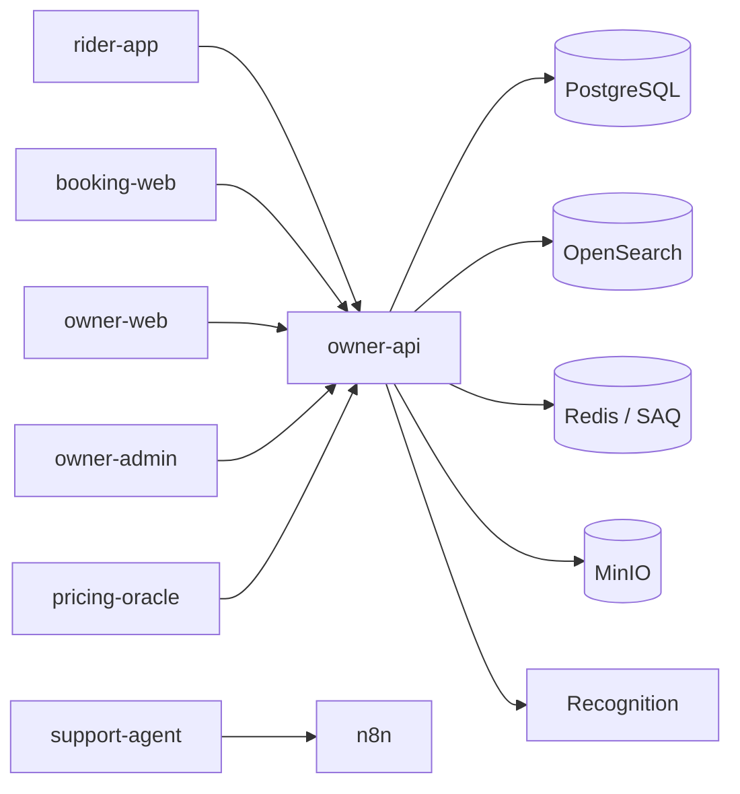

# Ownima — Vehicle Rental Management Platform

**One platform for rental businesses and their riders: fleet, reservations, pricing and finance.**

---

## Live products

| Product | URL | Audience |
|---|---|---|
| Ownima | [ownima.com](https://ownima.com) | Public site |
| Rider marketplace | [rider.ownima.com](https://rider.ownima.com) | Riders across all owners |
| Booking storefront | [booking.ownima.com](https://booking.ownima.com) | Riders of one owner |
| Owner cabinet | [beta.ownima.com](https://beta.ownima.com) | Rental owners |

---

## Platform

- Three roles: owner, rider, admin, with role-based access control.
- Fleet and vehicle management, images stored in MinIO.
- Reservations with real-time availability and a booking request flow.
- Pricing templates (seasonal, duration-based) and a market pricing oracle.
- Wallet, transactions and financial dashboards.
- Five locales in the rider apps: English, Russian, Thai, Indonesian, Vietnamese.
- Background jobs on a SAQ worker queue.
- AI support drafting and vehicle image recognition.

---

## Repositories

Most product repositories are private; `pricing-oracle` is public. Links work for Ownima members.

| Repository | Role | Stack |
|---|---|---|
| [owner-api](https://github.com/Ownima/owner-api) `(private)` | REST API, workers, Telegram bot, protobuf schema | Python 3.12 · FastAPI · PostgreSQL · OpenSearch · Redis · MinIO · SAQ |
| [owner-web](https://github.com/Ownima/owner-web) `(private)` | Owner dashboard, Capacitor mobile app | React 19 · TypeScript · TanStack · Tailwind 4 · Vite · bun |
| [owner-admin](https://github.com/Ownima/owner-admin) `(private)` | Internal admin panel | React 19 · TanStack Query · Radix · Tailwind 4 · Vitest · bun |
| [booking-web](https://github.com/Ownima/booking-web) `(private)` | Rider storefront for a single owner, embeddable widget | Nuxt 4 · Vue 3 · Pinia · TanStack Vue Query · Tailwind 4 · bun |
| [rider-app](https://github.com/Ownima/rider-app) `(private)` | Multi-owner rental marketplace | Nuxt 4 · Vue 3 · FSD · Pinia · Tailwind 4 · Vercel |
| [support-agent](https://github.com/Ownima/support-agent) `(private)` | AI support drafting, knowledge base, evals | Python 3.12 · Claude · n8n |
| [pricing-oracle](https://github.com/Ownima/pricing-oracle) | Rental pricing market intelligence | Python 3.12 · FastAPI · SQLModel · A2A · Fetch.ai |
| [ownima-blog](https://github.com/Ownima/ownima-blog) `(private)` | SEO site for the Thailand market | Astro 6 · TypeScript · pagefind · bun |
| [ansible](https://github.com/Ownima/ansible) `(private)` | Infrastructure, deployment, monitoring, runbooks | Ansible · Docker · Prometheus · Grafana · Loki |
| [ownima-workspace](https://github.com/Ownima/ownima-workspace) `(private)` | Workspace guide and shared agent skills | Bash · Markdown |

---

## Architecture

---

## For AI agents

Start at [ownima-workspace](https://github.com/Ownima/ownima-workspace): it holds the
workspace guide and the shared skills. Many repositories carry their own `AGENTS.md` or
`CLAUDE.md` with commands and rules; the workspace guide is the source of truth.

---

## Releasing

Release Please derives versions from conventional commits. See [RELEASING.md](https://github.com/Ownima/.github/blob/main/RELEASING.md).

---

## Team

| Role | GitHub |
|---|---|
| Backend / Architecture | [@zaebee](https://github.com/zaebee) |
| Product / QA | [@ownima-ivan](https://github.com/ownima-ivan) |
| Frontend | [@ReD1KC](https://github.com/ReD1KC) |

---

Contact: **contact@ownima.com**
Security: [private advisories](https://github.com/Ownima/.github/security/advisories/new)
